# 给 RAG 中台加一张概念图：一次完整设计的推演

> 本文解释的是**一份暂缓的设计**（记录在 [#197](https://github.com/Jenlybein/RAG-Core/issues/197)）。
> 它已经推演完、决策拍定，但**没有排期实现**。要开工，先进 #197 第 ① 步：把缺口量出来。
>
> 为什么把一份不实现的稿子写得这么细：因为「不做」也该有依据。上一版图谱被撤的时候，
> 理由是「价值未被证明」——那不是一份可复核的结论，只是一句诚实的话。这一次我希望
> 下一次重提它的人，能直接看到当时算过什么账。

---

## 三十秒版

**想加什么**：一张由大模型从正文里抽出来的**概念图**——节点是「东西」（会员等级、退款流程、抵扣积分），
边是它们之间的**语义关系**。抽一次，两个地方用：

1. **实体召回**：用户说「会员卡」，库里写「银卡会员」，靠别名表把两者认成一个，多召回一路；
2. **全局概览**：把实体聚成组，回答「这个库整体讲了什么」。

**为什么暂缓**：它很重（一次全量重建约 **390 次**模型调用，还要动两个响应契约），
而今天的语料（**21 篇 / 390 节**）基线 **R@5 已经 0.9488**——正落在「任何对照都测不出增量」的
天花板区间。**设计不是问题，证据是问题。**

---

## 一、先分清：这不是当年那张图

这个仓库里「知识图谱」四个字曾经指过一样东西，而且已经被否决过一次。不把这件事说清，
后面所有讨论都会跑偏。

| | 当年的图（ADR-0027，已否决） | 这一次的图 |
|---|---|---|
| 节点是什么 | **节**（标题层级里的一个节点） | **实体**（业务里的一个东西） |
| 边是什么 | 作者写下的**显式指路**（「详见 X 节」） | **语义关系**（触发、超期转、属于） |
| 边怎么来 | **确定性规则**抽（两条规则 + 三条守卫） | **大模型**抽（结构化输出） |
| 它回答什么 | 哪一节引用哪一节 | 哪些东西跟哪些东西有关 |

当年那张图**测量是好的**：补规则之后抽取 precision **1.0000** / recall **0.8421**。它被撤的理由
不是「正则不可靠」，是**价值不成立**——边只覆盖显式指路，而文档之间大部分有用关联是隐式的；
对照实验里它**注入 0 条**，因为实验语料只有 3 篇 15 节，候选池就是全库。

**这一次是另一张图，不是把旧图装回去。** 但有一点确实变了：语料从 3 篇 15 节长到 **21 篇 390 节**，
单通道一轮召回只覆盖约 20 节——当年「语料太小、无法测」这一条，今天**开始接近可以测了**。

---

## 二、整条链路长什么样

三段，顺序不能换：

- **索引期**：解析 → 切块 → **同一次模型调用**抽出「节说明 + 实体关系」→ 向量 / 关键词 / 实体三份索引 → 激活构建版本；
- **检索期**：三路召回 → 融合 → 重排 → 取 TopK → 折叠成一节一条结果；
- **概览**：独立端点，读同一批数据，聚成组再说人话。

两个细节值得先记住：**实体索引与切片属于同一个构建版本**（新切片不会配旧实体），
以及**全局概览是另一扇门**——它不进 `/rag/retrieve`，理由见第六节。

---

## 三、索引期：一次调用，两个产物

### 3.1 为什么能合并

索引期本来每个节就有一次模型调用：生成「本节在讲什么」，拼进检索文本。既然调用已经在那儿了，
把实体与关系放进**同一个结构化 schema**，全量重建仍是约 **390 次**，不翻倍。

技术上没有新基建：这个仓库的模型接口本身就是「先定字段再让模型填」（`chat_structured`），
拿不到合法结果就是失败、不退化成纯文本——而索引链路的既有纪律正是「任一步失败即整单失败」，
两者天然对得上。

代价是**失败面耦合**：一次不合规，两个产物都没了。但这笔账本来就在——两者都是索引期、都按节、
都走同一条失败纪律。

### 3.2 实体长什么样

**少量固定类型 + 关系词开放**。类型（会员等级 / 产品 / 流程 / 政策 / 金额 / 错误码）是一道
**免费的门**：实测里跨类型合并 **55 次错 54 次**（把人当机构、把机构当组织），加一道类型门就
把这类错误清零，而且不花一次模型调用。关系词则不设表，交给模型抽——维护一张关系词表是持续成本。

### 3.3 对齐：最贵的不是模型，是别名

模型逐节抽，「银卡会员」「银卡」「会员卡」会被抽成三个节点。不对齐，实体召回拿到的是散的三份索引。

做法是**三层瀑布**，越往后越贵：

1. **精确名 / 别名表**命中 → 直接合并（零模型调用）；
2. 未登记的候选先过**类型门**，再算名字相似度；
3. 只有落在 **0.65–0.95 之间**那一窄带里的，才让模型判一次。

三条实测教训支撑这个顺序：

- **只靠名字嵌入会反向**：不该合并的那一对相似度 **0.687**，真重复反而 **0.489**——名字向量不能独立判断；
- **候选生成是平方增长**（实测指数 1.99），所以窄带同时是成本控制；
- 跨类型合并绝大多数是错的，而类型门不花钱。

所以**别名表是这张图的地基**，且它必须能被人工改——业务里约定俗成的叫法（「会员卡」就是「银卡」）
只能靠人登记，模型猜不准。别名表做进控制台（最小面板：列表、增删改、租户内权限、审计），
**改完不自动重建**——重建是原子切换 + 约 390 次调用，一次误点不该变成一次全库重建。

### 3.4 度数：那张图里 71% 是孤点

这是参考同类系统时挖出来的、最值得抄的一句话。有人在自己的部署里审计过：**13,760 个文档派生实体里
9,806 个（71%）度数 ≤1**——只出现一次、没有任何关系。从孤点出发的一跳**无物可扩**，
实体召回会退化成名字匹配，还白花一次查询。

所以设计里加了一道门槛：**只有度数 ≥2 的实体才向外扩一跳**；索引期顺带算出**度数分布**
（实体总数、度 ≥2 占比、孤点比例）当健康指标。孤点实体仍然参与名字召回，只是不参与扩展。

---

## 四、状态：版本怎么活、怎么死

这张图是整个设计的骨架。它回答一个简单问题：**一次构建写下的那套东西，什么时候能用、什么时候不能用。**

- **构建中 → 就绪**：前者的前置条件是**四项计数相等**（知识库、切片、向量、关键词）——不相等不许上线。
  加了实体索引之后，这条闸门是「五份数据都齐」的意思。
- **就绪 → 生效**：**单事务**切换（旧版本归档 + 新版本生效 + 库的生效版本列更新，同成同败）。
- **生效 → 归档**：新版本上来，旧版本退位，但**不删**——回滚与同题对照都靠它。
- **构建中 → 失败**：任一步失败只落 `failed` 态，**线上照旧查旧的生效版本**。橙色那一步是设计焦点：
  **一次检索只读一个版本，不混排**。
- 虚线的「检索期」不是一个状态，是**只读关系**——它永远 pin 在生效版本上。

这条链最重要的性质是：**实体、边、聚类都是产物的一部分**，跟着版本同生共死。
于是「模型抽取不可复现」这件事不再是缺陷——同一版本内是快照（可比），跨版本不比边集、
只比检索指标。这是整个设计里唯一一处把弱点转化成架构的地方。

---

## 五、检索期：三路汇到一处

三路召回，最后扇入同一个融合步骤——**这就是这张图的结构故事**（注意右下角那个 `3 in` 徽标：
三路汇到一处，不是三条平行线）。

几条关键取舍：

- **实体召回是第三路召回，进 RRF 融合**，不是「注入位」。区别在于：注入项的分数是 0，
  **只有重排开着时才有机会**；重排一关，它必然被 TopK 截掉。既然它是一条正经的召回通道，
  就给它正经的分与名次。
- **查询期零模型调用**。认实体靠别名表 + 词典做确定性匹配。依据很硬：确定性方案能保留 LLM 方案
  **94%** 的上下文精度，而生产级检索可以做到零查询期模型调用、亚 200ms。
- **一跳限死为 1**，且只有度 ≥2 才扩（见 3.4）。多跳遍历在请求路径上撑不住，生产系统普遍这么选。
- **库里封闭，不跨库**。这条与文献里主流做法相反，但是有意的：图遍历会让向量层的范围预过滤失效——
  实测泄漏率从 0 推到 **0.95**、放大 **160–194 倍**，而这是「切片→实体→切片」这个二分拓扑的
  **结构性后果**。库内封闭把整类问题消掉，代价是失去「跨库指路」这个价值。

契约上的三处改动（这就是它「很重」的一半）：

| 改动 | 内容 |
|---|---|
| 分列字段 | 从五列变**七列**（多 `entity_score` / `entity_rank`，未命中仍是 `null` 而不是 0） |
| 降级原因 | 词表从四个变**五个**，新增 `entity search failed`（一因一码、不拼异常文本） |
| 开关 | **两层**：知识库级决定「建不建」，密钥配置级决定「用不用」 |

第二层之所以必须，是因为踩过同类的坑：只在密钥配置上开、而库根本没建图，
就会变成「开关打开了、什么都没发生」——所有用例都绿，没有一条生产调用会走进来。

---

## 六、全局概览：为什么它必须另开一扇门

一次概览是「对 N 份社区摘要做 map-reduce」，要 N 次模型调用。而 `/rag/retrieve` 承诺毫秒级、
查询期零模型调用——所以它**物理上进不去**。也别挂进受控 Research：那会把它既有的
「≤4 次模型调用」预算闸打穿。

于是：**新端点**，返回 `overview_blocks`（文本 + 证据下标 + `supported` / `insufficient`），
形状与既有的「引用块」同构——**仍然不是答案**，中台不生成给终端用户的答案这条边界没破。

成本上取的是 **Lazy 式**：聚类在索引期算（那是确定性计算，同一张图跑两次得到同一批组），
**摘要留到查询期现算**。索引成本因此大幅下降，代价是单次请求变贵——所以这个端点必须自带预算闸
（调用次数上限 + 超时，超了返回部分结果并说明原因）。

还有一条代价必须提前写进文档：**响应正文不可复现**。同一个问题两次调用，摘要文本不同；
引用仍然可回溯（证据是切片身份，机械可查），但正文不能缓存、不能逐字节对比。
**因此它永远只能当旁证，不能当门禁。**

---

## 七、验收：为什么现在的指标测不出它有用

这是整件事最扎心的一节。

**① 你的指标测错了对象。** 仓库现在的评测口径是 R@5 / hit@1 / MRR —— 全是 **hit 类**：
命中一条就算赢。而文献里能显出图价值的是 **strict recall**（一道题必须把**全部**证据都召回）。
一组实测把差距摆得很清楚：命中率 hit@10 **74.8%**，但 strict@10 只有 **13.3%**——
**图能「够到」对的文件，却拼不全证据。** 换句话说，你现在这套指标，恰好测不出图唯一能改善的那件事。

**② 现成的题不够用。** 现有 137 道题的金标是「文档 + 标题路径」：

| 每题金标节数 | 题数 | 对 strict 意味着什么 |
|---|---|---|
| 1 节 | **116** | strict ≡ hit，没有新信息 |
| 2 节 | **15** | strict 才有意义——但只有 15 道 |
| 0 节 | 6 | 不可答 / 假前提类，不进召回分母 |

15 道题里翻一道就是 **±6.7 个百分点**，不足以当闸门。所以要**扩到约 50 道**（翻一道约 ±2 个点）。

**③ 闸门判据**：strict 相对提升 **≥10 个百分点**，且逐节 R@5 **退化 ≤1 个百分点**。
参考量：文献里多跳类的图增益通常是个位数 F1（+1.6 ~ +3.3），所以 10 个点不是低门槛。
样本小，还要同时报逐题拆分与区间——**别只看总数**。

**④ 语料本身也在天花板附近。** 固定查询、只往语料里加干扰文档，doc-level recall@10 的实测曲线是：
**1.000（16 篇）→ 0.975（54 篇）→ 0.938（100 篇）→ 0.750（1128 篇）**。
反过来读：16 篇以内任何系统都是满分，那里的图对照是**构造性无效实验**——这正是当年「注入 0 条」的翻版。

---

## 八、那为什么还是暂缓了

三条，都很直白：

1. **贵。** 全量重建约 390 次模型调用；在两个响应契约上留下永久痕迹；别名一改就要重建——
   这笔钱会反复付。而另一个同类系统已经证明了这种「全删全算」的重建方式有多难受
   （随机 chunk id 连缓存都命中不了，成本随重建次数线性叠加）。
2. **测不出。** 上面那一节：指标测错了对象、题不够、语料在天花板。**做完也很可能拿不到能站的数**。
3. **上限不高。** 文献里图在多跳上只赢个位数，在**单跳上会输**，在纯事实检索上甚至
   低 **11.6** 个百分点；查询期 token 成本是 **44×–377×**。它不是万灵药，只是特定题型的补丁。

所以结论不是「这个想法不好」，是**「现在动手，会在拿到证据之前先把钱花完」。**

---

## 九、从别人家的实现里拿走了什么

参考过腾讯开源的 **WeKnora**（它确实做了 LLM 知识图谱，而且是按块抽、写进图数据库、
从实体走回原文块、只有一跳、命中分数为 0 交给重排）。最后：

**借了四条**——「实体 → 原文编号 → 走回原文」这条形状；两层开关；「图是索引策略的一路，不是外挂」；
「硬上限 + 只扩一跳」。以及两条警示：**孤点成灾**（71%）与**重建全删全算**。

**没借三条**——它**在查询期用模型抽实体**（与本设计的零模型调用相反）；
它**按名字合并**（最没章法的一步）；它的**命中分数为 0**（依赖重排，重排一关就失效）。

顺带一个结论：**它没有社区摘要**。所以「全局概览」这一半参考不了它，只能参考 GraphRAG 那一系，
而 LazyGraphRAG 那条「索引期不算、查询期才算」正是我们选的路径。

---

## 十、如果哪天要开工

顺序写死在 #197 里，五步，第 ④ 步是闸门：

1. 补 `strict recall` 指标（小时级）+ 扩多证据题到约 50 道 + **量一次基线缺口**；
2. 抽边与落库（离线，先不动召回）；
3. 接第三路召回（同时改三个契约面）；
4. **验证闸门**：strict +≥10 点且 R@5 退化 ≤1 点才继续；
5. 全局概览。

**如果第 ① 步量出来的缺口只有 2–3 个点，整件事就应当停在那里**——那时这份设计会作为
「考虑过、不值得」的记录留着，而且这一次是有数据的。

再往前一步的判断依据也写在 #197 的「翻案条件」里，包括：注入／召回采纳率极低时**先查种子与度数门槛、
不要靠加分数救它**；出现「同一实体在多个库都要连起来」的真实需求时，才重开跨库那扇门。

---

## 附：术语与两处未定

**术语**：本文用仓库术语表里的词。其中「实体关系图（知识图谱）」一条已登记，
并明确它**不等于**已退役的「节级关系边」。其余新词（实体召回、一跳、别名表、全证据召回）
等开工或验证通过时再补，避免暂缓期反复改术语表。

**两处我建议、但你没有显式拍板的**（不同意就推翻，不影响其余决策）：

1. **存储用关系库三张表**（实体 / 实体出现 / 关系 + evidence 原文片段），不引入图数据库。
   理由：只查一跳、库内封闭后规模很小；多个成熟系统的共识是「图库是商品，质量不由库决定」；
   而关系上的 `evidence` 片段可以直接喂既有的**引用回溯率**指标。
2. **一跳限死为 1 跳**。理由见第五节——多跳在请求路径上撑不住。

**图怎么改**：三张图的源文件是 `diagrams/*.html`（自包含、可直接浏览器打开），
`diagrams/*.svg` 是从源导出的交付版；改图请改 HTML 后重新导出，不要直接编辑 SVG。
