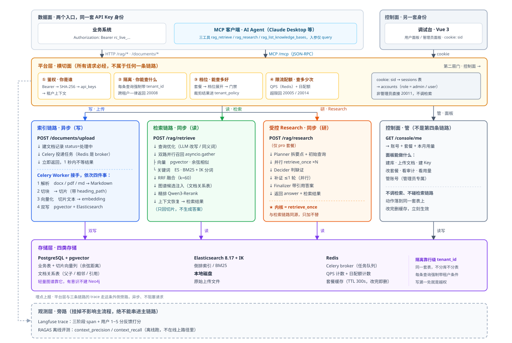
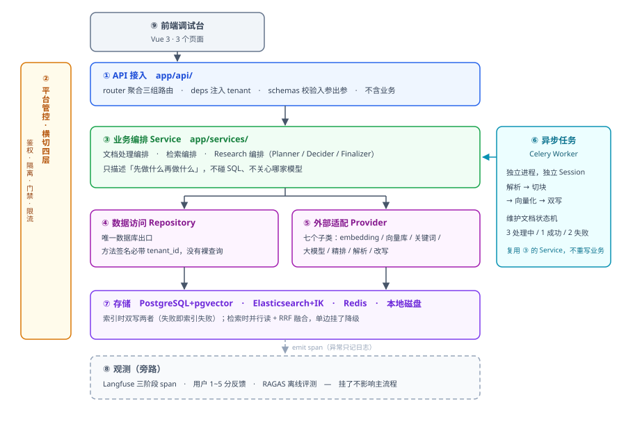

# RAG-Core 架构

本文讲系统整体怎么运转：五层全景、九个模块、两条主链路、链路与连接、降级约定、评测，以及每个模块的实现要点。设计动机与代价见 [设计决策](设计决策.md)。

## 五层全景

一张图记住整个系统，后面每一节都是在给它的某一块填肉。



图中四处刻意的画法，就是理解这个系统的关键：

- **平台层是横条，不是最上面一层** —— 它横跨在所有链路的入口上，每条请求都必须穿过它。但它是一条带**两扇门**的横条：左门认 API Key，右门认登录会话。
- **索引链路与检索链路完全并列** —— 中间没有箭头，写和读互不等待，是两个独立进程。
- **控制面是灰色的「管」列，不是第四条链路** —— 它只走 `/console/*`，拿会话认人。数据面的身份是 `api_keys`，面板的身份是 `sessions`，**两套不能混**（混了就是前端拿 Bearer 打面板、或后台用 cookie 查检索，两边都 401）。
- **观测层是虚线框，而且走最外侧** —— 它是请求链路的**埋点上报**，不是从存储层扫库统计。挂掉不影响主流程，绝不能用实线串进链路。

**受控 Research** 是后期叠加在检索内核 `retrieve_once` 上的第三条分支：它和写 / 读并列从平台层分出，但性质是「能力叠加、不替换原链路」，内部复用检索链路的检索内核。所以它算一条链路分支，却不是与索引 / 检索并列的「又一条主链路」。

**数据面不止 HTTP 一种入口**：`POST /mcp/`（JSON-RPC）让 AI Agent 通过两个工具调用（`rag_retrieve` / `rag_list_knowledge_bases`）进数据面，检索入参只有 `kb_ids` + `query`——配置全在 Key 引用的密钥配置上（`rag_research` 留给第 9 步）。它与 HTTP 共用同一道平台层判定内核（`app/core/auth.py`），不另起链路，最终驱动的还是检索链路。

**控制面是另一条独立通道**：本步已落地登录 / 登出 / `/console/me` / 套餐与账号管理 / 审计；租户侧面板业务（库、文档、Key 的增删改查）与前端留到第 8 步。它和数据面**共用后端、共用同一套表，但不共用身份**，也不进检索链路。数据面另有一扇 `GET /api/v1/auth/me`（只认 API Key），供外部程序查自己的余量；两扇 `/me` 刻意不合并（见本节末「两个 `/me` 分工」）。

五层里**平台层**最特殊——它不处理业务，横跨在所有链路入口上，干四件脏活：认证你是谁、限制你能查什么、限制你能查多少次、限制你能查多好（档位解析与裁剪回显）。

> 画图时最容易错的三处：平台层是**横跨**的（不是最上面一层）；观测层是**旁路**的（不能用箭头串进主链路，也不是从存储层扫库）；控制面是**另一套身份**（不能和 API Key 挤在同一扇门里）。

## 九个模块

五层图是「运行时切面」——它告诉你请求怎么流。要读懂代码、知道改哪里，关心的是**模块**：把系统按职责切成一块块可独立理解、可独立替换的构件。

RAG-Core 拆成 **9 个模块**（前 8 个后端 + 1 个前端）：

| 模块 | 代码位置 | 一句话职责 |
| --- | --- | --- |
| ① API 接入 | `app/api/`（路由在 `app/api/routes/`） | 收 HTTP 请求、入参校验、注入租户上下文，不含业务 |
| ② 平台管控 | `app/core/auth.py` + `app/core/console_auth.py` + `app/services/`（白名单 / 档位 / 配额） | 鉴权、数据范围、套餐门禁、限流与配额、控制面会话 |
| ③ 业务编排 | `app/services/` | 最厚一层：文档处理 / 检索 / Research 三大编排，外加查询改写与同义词（`services/query/`） |
| ④ 数据访问 | `app/repositories/` | 唯一数据库出口，每条查询强制带 `tenant_id` |
| ⑤ 外部服务适配 | `app/providers/`（六类） | 封装 embedding / 向量库 / 关键词 / 大模型 / 重排 / 解析 |
| ⑥ 异步任务 | `app/tasks/` + Celery | 索引链路的异步执行：解析 → 切块 → 向量化 → 双写 |
| ⑦ 存储 | PostgreSQL + pgvector / ES / Redis / 磁盘 | 业务表 + 向量 / 倒排 / 缓存计数 / 原始文件 |
| ⑧ 观测 | `app/observability/` + Langfuse + RAGAS | trace、反馈、离线评测，旁路 |
| ⑨ 前端调试台 | `frontend/`（Vue 3） | 用户面板（本租户：库 / 上传 / Key / 检索调试）+ 管理员面板（admin：账号 / 套餐 / 审计） |



读这张依赖图要抓住四条规则：

1. **① 不能跳过 ③ 直接调 ④** —— 一旦允许跳层，租户隔离和业务规则就有了旁路，后面再也管不住。
2. **② 是竖条不是一层** —— 它不参与调用链，而是贴在每一层的侧面做检查，所以画成横切而不是堆叠。
3. **⑥ 是独立进程，但复用 ③ 的 Service** —— 索引任务不重写一遍业务逻辑，否则「同步索引」和「异步索引」两套代码迟早不一致。
4. **⑧ 用虚线且没有反向箭头** —— 它只单向接收埋点，绝不介入主流程；停掉 Langfuse 后检索必须照常返回，这是验证旁路的唯一有效方式。

模块和五层不是两套体系，是同一系统的两种剖面：**五层是请求的横切视图，模块是代码的纵向切分**。

## 两条主链路

### 索引链路（写，异步）

```
POST /api/v1/documents/upload
  → 建文档记录，status=3（处理中）
  → Celery 投递任务（Redis 当 broker）
  → 立即返回（1 秒内，不等处理结果）

Celery Worker 接手，干四件事：
  1 解析  ：docx / pdf / html / md / txt → Markdown 化文本
  2 切块  ：Markdown → 结构化切片（带 heading_path；片内窗口按 token 切分）
  3 向量化：切片文本 → embedding 向量
  4 双写  ：pgvector（向量列）+ Elasticsearch（倒排索引 / BM25）——**目标形态**；第 3 步只写 pgvector，第 4 步接 ES
```

### 检索链路（读，同步）

```
POST /api/v1/rag/retrieve
  → 查询优化（改写 / 同义词）
  → 双路并行召回
       ├ 向量召回（pgvector，余弦距离）
       └ 关键词召回（Elasticsearch，BM25）　← 两路都带 tenant / kb / index_version / doc_version 谓词
  → RRF 融合
  → 图谱候选注入（后期能力）
  → 重排（专用端点 qwen3.7-text-rerank；关闭时整段跳过）
  → 上下文恢复
  → 返回检索结果
```

### 为什么必须是两条链路

| 对比 | 索引链路（写） | 检索链路（读） |
| --- | --- | --- |
| 触发频率 | 低（传文档时才跑） | 高（每次提问都跑） |
| 单次耗时 | 秒级到分钟级（要调 Embedding、要写两个库） | 毫秒级（实测逐题 P95：重排关 0.72s、重排开 1.18s，见「评测」一节；目标 P95 < 2 秒） |
| 执行方式 | **异步**（丢给 Celery Worker） | **同步**（请求内跑完） |
| 失败影响 | 只影响这一篇文档，可以重试 | 直接影响用户体验 |
| 状态管理 | 需要状态机（处理中 / 成功 / 失败） | 无状态 |

如果把索引做成同步的：用户上传一个 50 页的 PDF，接口要等十几秒才返回，期间 HTTP 连接一直挂着，Nginx 可能超时断开，用户以为失败了又点一次，于是同一篇文档被索引两遍。而且这篇文档的索引失败，不该让整个服务变慢。

所以索引必须异步，检索必须同步——用户问问题，等不了。

> 第一期其实是**同步索引**的，当时的考虑是「先跑通主链路，少启动一个 Redis 和一个 Worker，心智负担小」，后来才改造成异步。演进顺序不影响最终结论，但解释了为什么早期版本少两个进程。

## 存储与降级

### 四类存储

- **PostgreSQL + pgvector** —— 业务表 + 向量列（余弦距离）；索引链路在单事务内 purge + 写入
- **Elasticsearch + IK** —— 倒排索引 / BM25；目标形态，第 4 步接入
- **Redis** —— Celery broker（0/1 号库）+ 两级 QPS / 日配额计数（`quota:` 前缀）+ 套餐缓存（2 号库，`plan:` 前缀）
- **本地磁盘** —— 原始上传文件（重解析原料）

pgvector 与 ES **双写**是为了混合检索（向量 + 关键词互补）；双写是**目标形态**，第 3 步只写 pgvector。`purge_document_chunks` 遍历的是**存储列表**，第 4 步接 ES 时只需往默认接线里 append 一个实现。Redis 既当消息队列、计数器又当套餐缓存的载体，省去额外组件。

目标形态下，双写只在**索引时**做，且不降级——一边写失败就是索引失败，否则「向量库有、ES 没有」的数据不一致比报错更糟。检索时是**并行读 + 融合**：`asyncio.gather` 同时查两边，任一边挂了降级另一边。

### 外部依赖挂了会怎样

| 依赖 | 挂掉后的行为 | 请求会失败吗 |
| --- | --- | --- |
| Embedding 服务 | 索引侧：可重试，重试耗尽标记失败<br>检索侧：向量分支失败，降级为纯关键词 | 索引：该文档失败<br>检索：不失败（降级） |
| 大模型服务 | 查询改写失败 → 用原句继续<br>检索结果组装失败 → 跳过该能力 | 不失败（降级） |
| 重排服务 | 保留融合后的原始顺序（降级原因固定 `rerank failed`） | 不失败（降级） |
| PostgreSQL | 核心依赖，无备份方案 | **失败** |
| Elasticsearch | 混合检索降级为纯向量；纯关键词模式直接失败 | hybrid 不失败，bm25 失败 |
| Redis | 索引任务投递阻塞；限流计数失效 | 索引阻塞 |
| Langfuse | 只打日志警告，不抛异常 | 不失败 |

规律是：**所有非核心依赖坏了，请求依然返回 `code: 0`**，成败信号藏在响应的 `metadata.degraded` 字段里。

第一次见会觉得反直觉——出问题了怎么还算成功？但对调用方来说，「拿到 8 条结果，其中 3 条是降级后的次优结果」比「接口报错，一条都没有」有用得多。

## 链路与连接

一次检索要打三类模型端点（嵌入 / 改写 / 重排）加两个库。连接怎么建、谁负责关，同时决定延迟与「有没有悄悄降级」，所以它自成一段。第 11 步收口之后，这件事只剩两句话：**一个进程一个 HTTP 客户端**、**请求路径上一套数据库连接池**。

### 一、进程级 HTTP 客户端 · `app/core/http_clients.py`

- **一个进程一个 `httpx.AsyncClient`**，模型类流量共用它的连接池；同一个循环里取多少次都是同一个实例。
- **为什么第 11 步才敢这么写**：异步客户端的连接池绑在**创建它的**那个事件循环上，跨循环复用会当场 `RuntimeError: Event loop is closed`（ES Provider 与 Celery 各付过一次学费）。第 10 步之所以要一张「按 loop 注册」的表，是因为那时同一个进程里同时活着好几个长活循环——检索执行池的 4 条常驻线程各一个、Celery 每个任务又一个。第 11 步把这两件事都消掉了（执行池删除，见下一节；Worker 换成常驻循环，ADR-0023），一个进程只剩一个循环，那张表就退化成一个槽。完整理由与翻案条件见 [ADR-0024](adr/0024-end-to-end-async.md)。
- **那条硬约束仍然守着**：槽里记着「这个客户端属于哪个循环」，循环一变就重建、旧的丢掉（并记一条 warning）。生产里这个比对恒为真，它只服务测试（一个用例一个循环）与脚本残留。
- **超时不写在客户端上**：用途各有预算（大模型 / 嵌入 60s、重排 15s），所以超时由**调用方按用途传** `timeout=`，客户端上的默认值只兜「忘了传」。
- **另有一个进程级同步客户端**：LangChain / OpenAI SDK 的包装对象在构造时**即使拿到异步客户端也会顺手建一个同步 `httpx.Client`**（本机实测约 43 ms/次，Windows 的代理环境探测）。不共享它，复用收益会被这一项吃掉；同步客户端不绑事件循环，所以进程级一个就够。
- **收尾是确定性的**：`aclose_http_client()`（API 的 lifespan、`WorkerLoop.shutdown`），幂等、没有就是安静 no-op；关不掉的只记 warning，不抛——收尾阶段抛异常会盖掉真正的退出原因。改造前每轮约 127 条 `Event loop is closed` 噪音，改造后为 0。

### 二、检索执行池：已删除（第 11 步票 #127）

第 10 步曾经有一个**固定规模的检索执行池**（`app/core/loop_pool.py`，4 条常驻线程各持一个常驻 loop、排队预算 2 秒）。它存在的唯一理由是：混合检索的向量分支里有**一次同步的 pgvector 查询**，会卡住所在的事件循环。

第 11 步把那次查询换成 `await db.execute(...)`（`PgVectorStore.similarity_search_scope` 收 `AsyncSession`）之后，这条理由消失了，池连同 `RETRIEVAL_POOL_SIZE` / `RETRIEVAL_QUEUE_BUDGET_MS` 两个配置键、`tests/test_loop_pool.py` 一起删除。现在：

- 两路召回都是**主循环上的普通协程**，向量一路用**请求的异步会话**；
- **取消能传导**：客户端断开时 `CancelledError` 直接进到正在 await 的嵌入 / 召回里，活当场停下（执行池时代只能取消「等结果」）；
- 「排队超预算 → 这一路失败」这条降级路径**不复存在**，也不再需要——并发上限回到数据库连接池与模型端点。

池删除之后，「同一个进程里多个长活循环」这个前提也跟着没了，于是按循环注册的客户端在票 #134 进一步收敛成进程级一个（上一节）。历史理由见 [ADR-0022](adr/0022-rerank-endpoint-and-loop-isolation.md)，取代它的决定见 [ADR-0024](adr/0024-end-to-end-async.md)。

### 三、两种模式用的是同一条会话

单模式与混合模式现在都跑在主循环上、都用请求的 `AsyncSession`。第 10 步「单模式留在主循环」是**因为同步 `Session` 不是线程安全的**；异步会话不绑线程，这条约束随之消失，「一个请求一条连接」成为两种模式共同的事实。

**收尾分三处**：API 进程在 lifespan 退出时关那一个客户端；Celery Worker 用**进程级常驻循环**（`app/db/worker_loop.py`，ADR-0023），收尾发生在 `worker_process_shutdown` 信号里——在循环**还活着的时候** `dispose` 异步引擎、关掉 HTTP 客户端，然后才停循环（票 #132 起索引任务就投在这个循环上；任务体里**不再**关客户端，否则等于每个任务把共享客户端关掉）。评测脚本没有 lifespan，靠 `atexit` 兜底。

### 四、数据库连接预算：一套 + Worker 常驻循环

请求路径上只有**一套**连接池：异步的 `AsyncSessionLocal`（`app/db/async_session.py`）。第 11 步之前这里是「两套」（同步 15 + 异步 15 每进程），那是迁移期的形状；迁移完成后请求路径上不再有同步会话——`get_db` / `get_transaction` 两个 FastAPI 依赖连同调用点一起删了（票 #134）。

| 池 | 位置 | 每进程上限 | 谁在用 | 池参数 |
| --- | --- | --- | --- | --- |
| 异步 `AsyncSessionLocal` | `app/db/async_session.py` | **15** = 5 + 10 | 请求路径、Worker 索引任务、旁路短事务——**全部**数据库流量 | 显式：`pool_size=5`、`max_overflow=10`、`pool_pre_ping=True`、`pool_recycle=1800` |
| 同步 `SessionLocal` | `app/db/session.py` | **15** = 5 + 10（实际常数 1~2 条） | 只剩三处不在请求路径上的读者，见 [ADR-0024](adr/0024-end-to-end-async.md)：Provider 装配期的角色指针、运行时配置热刷新（线程池里）、运维脚本与启动期装载 | SQLAlchemy 默认值 |

**为什么同步那一套还在**：`get_llm_provider(role)` 是同步工厂，而 Provider 层按约定不认识数据库（ADR-0011 的层向），所以「这个角色现在指向哪条模型接入」只能当场读库；另外两处（配置热刷新、运维脚本）也各有它必须同步的理由。四处都不是请求路径，翻案条件写在 ADR-0024 里。

**算式**（`max_connections` 要 ≥ 下面这一行；同步那一套按「两套都满」给上界，虽然它的实际占用是常数）：

```
总连接数 = 15 × API 进程数 + 15 × Celery 子进程数 + 15 ×（同步侧：每进程一份上界）+ 15（Alembic / 评测脚本）+ 10（余量）
```

- **API**：`deploy/docker-compose.yml` 起一个 uvicorn 进程（没写 `--workers`）。多 worker 时按 worker 数乘。
- **Celery**：prefork 每个子进程一套异步池，`concurrency` 缺省 = CPU 核数，所以 N 核就是 `15 × N`。索引任务走的是**子进程里那个常驻循环**上的异步池（ADR-0023），仍然是「每进程一套」——并发由进程数给，不由循环数给。
- **同步侧**：每进程的上限仍是 `5 + 10`，但实际只会借 1~2 条（装配期的一次主键查询、一次配置刷新）。算式里按满额算，是给迁移脚本与将来多一条读者的余量，不是当前占用。
- **Alembic / 评测**：迁移脚本继续用同步引擎（同步迁移不在本步范围），评测脚本进程内跑检索，各算一份。

以「1 个 API 进程 + 4 核 Worker」为例：`15×1 + 15×4 + 15×2 + 15 + 10 = 130`。PostgreSQL `max_connections` 缺省是 100，所以要么把 Worker 并发压到 2，要么把 `max_connections` 提到 200；上线前用 `pg_stat_activity` 里本库的连接数核一次真实值，不要只信算式。

**监控口径跟着实现走**：迁移前看的是「向量分支在池里排了多久」（`queue_wait_ms`，随执行池在 #127 一起删除）；现在看的是「池里借不到连接」——`pool_size + max_overflow` 用满之后，`pool_timeout`（缺省 30 秒）会把请求拖成超时。Worker 侧另有一条读数：`WorkerLoop.shutdown()` 在 `dispose` 之前记一行 `worker_loop_pool_state`（`pool_size` / `checked_out`）——关停时 `checked_out` 不为 0 就是连接泄漏的形状。

> 迁移是按垂直切片推进的（票 #126 铺异步地基；#127 检索链路、#128 观测与反馈、#129 控制面读、#130 控制面写、#132 数据面上传与索引）。**第 11 步已在票 #134 收口**：请求路径上只剩 `AsyncSession`，依赖树里只允许出现 `get_async_db` / `get_async_transaction`（结构守卫见 `tests/test_console_async_reads.py` / `test_console_async_writes.py`），提交点仍然只有一处（`app/db/transaction.py` 的 `async_transaction`）。剩下的同步读者不在请求路径上，逐个写在 ADR-0024 的「还剩一处」一节。

## 模块详解

### ① API 接入 · `app/api/`

只做 HTTP 这一层的事：`router.py` 把 `knowledge_bases` / `documents` / `rag` 三组路由聚合到 `/api/v1`；`deps.py` 用 FastAPI 依赖注入 `get_current_key`，把请求交给平台层判定内核、拿到租户 / Key / 密钥配置 / 套餐；`schemas/` 用 Pydantic 校验入参、序列化出参。不含任何业务逻辑。（MCP 入口 `POST /mcp/` 也在这里接入，与 HTTP 共用平台层内核，不另起业务；控制面的 `/console/*` 是另一组路由、另一套身份。）

把「协议细节」和「业务」彻底隔开。因为这一层不写业务，换前端、加接口、做版本升级都不会动到核心逻辑——这也是迭代里改动最少的一层。

```
HTTP 请求
  → 路由匹配到具体 handler
  → 依赖注入 get_current_key：判定内核解出租户 / Key / 密钥配置 / 套餐
  → 调用对应 Service（把 HTTP 对象转成领域对象）
  → Service 返回结果 → schema 序列化为 JSON 响应
```

### ② 平台管控 · `app/core/auth.py` + `app/core/console_auth.py` + `app/services/`

数据面与控制面是**两套身份、两份代码**，不共用任何鉴权函数：数据面只认 `Authorization: Bearer` 里的 API Key，控制面只认 `console_session` cookie。浏览器不会带 `Authorization`，而数据面的 Key 也绝不该能用来管理平台——两个方向都是事故。

- **鉴权（数据面）**：`Bearer token → 按明文查 api_keys（ADR-0004）→ Key 所属租户（必须是 active）→ 它引用的密钥配置 → 租户当前套餐`。四种失败（没带 token / Key 不存在 / Key 停用 / 租户停用或缺失）全部是 `20010`，消息可区分，但对外不区分「Key 不存在」与「Key 属于别人」。
- **挂载方式是路由级依赖，不是中间件**：HTTP 侧是 `app/api/deps.py::get_current_key`，MCP 侧是 `app/mcp_server.py` 里的薄适配器，两者都把请求对象交给同一份判定内核 `app/core/auth.py::resolve_identity`。内核只认「一个有 `headers` 的对象」，不 import 任何 Web / MCP 框架；这是「HTTP 与 MCP 只有一份规则」的落地方式。
- **控制面（`app/core/console_auth.py`）**：读 `console_session` cookie → `sessions` 行 → `accounts` 行，每一步不成立都是 `20010`；角色与账号状态**每个请求现读**，所以停用、降级在下一个请求生效。写操作另要求 `x-requested-with: XMLHttpRequest`（`20011`），挡跨站请求；登录接口本身不带 cookie，不在这一条之内。
- **隔离**：所有数据库查询强制带 `tenant_id`（Repository 方法签名要求）；数据面再叠一层「这把 Key 能查哪些库」的白名单。越界与跨租户一律「知识库不存在」（`20008`），绝不返回「无权限」。

**隔离在三处同时强制**（不是「提醒记得加」，而是「写不出来」）：

- Repository 方法签名第一个业务参数就是 `tenant_id`，**不存在不带 tenant 的查询方法**；
- pgvector 查询：`.where(Chunk.tenant_id == tenant_id, Chunk.kb_id == kb_id).order_by(Chunk.embedding.cosine_distance(q))`；
- Elasticsearch：`"filter": [{"term": {"tenant_id": tenant_id}}]`（`filter` 不参与评分，比 `must` 快）。

身份与控制面共七张表，都不加外键、id 保持裸字符串（只有 `plans` 用整数自增主键）：

| 表 | 一行是什么 | 要点 |
| --- | --- | --- |
| `tenants` | 一个客户 | `plan_id` 非空；`status=disabled` 让它的全部调用立刻失败 |
| `plans` | 一档套餐 | 档位白名单 + 4 个能力开关 + 6 个数值上限，共 11 个业务列；**库是真相**，预设只是首启种子（ADR-0017） |
| `accounts` | 一个登录账号 | `tenant_id` 可空：管理员不属于任何租户；`password_hash` 只存哈希 |
| `key_policies` | 一套密钥配置 | 五组内容；`profile` 与两个结果形状开关都在这里 |
| `api_keys` | 一把数据面凭证 | `policy_id` 引用配置；`key_value` 本期明文 + `label` 备注名 |
| `sessions` | 一次登录 | 行 id 即凭证；角色与状态不存这里，每次回账号表现读 |
| `audit_logs` | 一条改动 | 动作名 + 目标 + 改前 / 改后快照；`actor_id` 可空（系统动作没有「人」） |

**`plans` 的主键是整数，这是决定，不是遗留**：套餐 id 是内部键，调用方从来只见 `code`（脚本入参、错误信息、响应里出现的都是 `free` / `standard` / `pro`）。整数自增让 `tenants.plan_id` / `accounts.plan_id`（将来别的引用方同理）只存一个数字，比裸字符串紧凑，改 `code` 时也不牵动引用。其余六张表的 id 是裸字符串，因为那些 id 本身就是被 URL、日志与调用方引用的标识——两种形态各自服务于「谁会被外面看见」。

**列库也按同一份白名单过滤，这是第 7 步补充的决定（spec 只要求锁住检索）**：白名单定义的是这把 Key **能看见**哪些库。列库若把租户拥有的库全部列出来，等于回答「这些库存在、但你不许用」，泄露的是租户的库清单——调用方不必越权就能数清这个租户有多少库。因此列库与检索判同一份范围，只是反应不同：检索撞到范围外**拒绝**（`20008`），列库把范围外的**直接去掉**，不为一条不可见的库让整份清单失败。

**一把 Key 就是一套授权，而它引用一套独立的密钥配置**。`api_keys` 只存凭证本身（`key_value`、`label` 备注名、`status`、`last_used_at`）与 `policy_id`；配置在 `key_policies` 表里，归租户所有、租户内可复用（本期按一对一用），内容是五组：**数据范围**（`allowed_kb_ids` 白名单）、**能力开关**（Research / 混合检索 / 重排 / 查询改写）、**限额**（QPS 与日配额）、**默认档位**（`profile`）、**结果形状偏好**（`include_parent` / `expand_table_rows`）。`profile=custom` 时这里还存那批手动参数（检索方式、返回条数、是否重排、是否改写）。**并发处理数是套餐的列，不是 Key 的列**。删除配置时，引用它的 Key 字符串级失效——Key 本身还是 active，但下一次判定按「Key 停用」失败。一个租户可以有多把 Key，分发给不同外部应用 —— **Key 本身就是应用身份**，请求里没有单独的 `app_id`。同一把 Key 同时用于 HTTP 与 MCP 两条入口，所以编排层不关心请求从哪条入口进来。

**Key 明文存储，本期取舍**。生成时 `rc_live_<32位hex>`，直接存 `key_value` 与 `label`（备注名）；不存哈希——调试台要拿它打真实接口。生产应改成「哈希 + 密文」或「明文只展示一次」。**完整论证与代价 → [ADR-0004](adr/0004-plaintext-key-storage.md)。**

判定内核的实际形状（省略了失败分支与参数校验）：

```python
def resolve_identity(request, db, *, auth_enabled=None, plan_cache=None) -> KeyContext:
    token = _bearer_token(request)                    # 没有 token → 20010
    if not (settings.AUTH_ENABLED if auth_enabled is None else auth_enabled):
        return _dev_identity()                        # 开关关：合成的「全能力 + custom」身份
    return _identity_from_key(db, token, plan_cache=plan_cache)
        # 明文查 api_keys → 检查 Key/租户状态 → 读 key_policies → 读租户当前套餐
```

**三层授权，互不重叠**。三层是包含关系，不是并列关系：配置只允许在套餐划出的范围内分配，请求只允许在配置圈定的范围内收窄。

| 层 | 回答什么 | 谁定 | 落在哪 |
| --- | --- | --- | --- |
| 请求 | 问什么、查哪些库 | 调用方，每次给出 | 请求体只有 `kb_ids` + `query` 两个字段，`extra="forbid"` |
| 密钥配置 | 这套集成能用多好、能用多少 | 租户管理员签发 Key 时选定 | `key_policies`（Key 通过 `policy_id` 引用） |
| 套餐 | 这个租户买得起多少 | 平台管理员授权 | `plans`（进库、可改、可预览、可追责） |

档位四选一，**建 Key 时定下、调用方改不了**；命名档位是**完整替换**，`custom` 才读配置里的手动参数：

| 档位 | 检索方式 | 返回条数 | 重排 | 查询改写 | 哪些套餐允许 |
| --- | --- | --- | --- | --- | --- |
| `speed` | 向量 | 5 | 关 | 关 | free / standard / pro |
| `balanced` | 混合 | 5 | 关 | 关 | standard / pro |
| `quality` | 混合 | 5 | 开 | 开 | pro |
| `custom` | 读配置手动参数，逐键回落部署缺省 | 配置值（夹到平台硬上限 50） | 配置值 ∧ 部署能力 | 配置值 ∧ 部署能力 | standard / pro |

**档位是意图，部署开关是能力，生效值 = 两者的合取**：`RERANK_ENABLED` / `QUERY_REWRITE_ENABLED` 关着时，档位不会凭空变出一个没装配的 Provider——回显写着「重排开了」而日志里一次模型都没调，比不承诺更难查。重排这一侧还有第二层：`RERANK_ENABLED=true` 但端点没配齐（地址或密钥缺一）时，工厂给的是空实现、回显 `applied=false`，**不回落**大模型重排。

**五道门禁 + 两种超限反应**（`app/services/profile_policy.py`，顺序不可换）：

| # | 判什么 | 不通过 |
| --- | --- | --- |
| 1 | 档位在套餐的档位白名单内 | `20013` |
| 2 | 展开档位（命名档位查预设；`custom` 读手动参数） | — |
| 3 | 命名档位所需的每个能力都被套餐允许 | `20013`（**拒绝，不降级**：名字是产品契约） |
| 4 | `custom` 档参数裁到套餐上限与平台硬上限 | 不报错，**裁剪 + 回显** |
| 5 | 单次检索库数 ≤ `max_kb_per_retrieve` | `20013`（**拒绝，不裁剪**：悄悄少查库会改变「问什么」） |

**裁剪有两个来源**：套餐上限（`mode` / `rerank` / `rewrite`）与平台红线（`top_k` 夹到 `MAX_TOP_K=50`）。后者不来自套餐——套餐里没有「返回条数」这一列，条数不是成本旋钮——但平台红线必须始终成立：调用方不能靠一次请求把整个库拖回来。所以 `custom` 档的超限既受套餐夹，也受平台夹；两条来源都写进同一份 `clipped` 回显。

**响应每次都带 `metadata.tenant_policy`**：`plan` / `requested_profile` / `mode` / `top_k` / `rerank` / `rewrite` / `kb_count` / `clipped`。它们从同一份已解析参数上读出，不存在第二个真相——调用方因此能解释「为什么这次慢了」「为什么没重排」「哪些参数被裁了」。

**配额分两类存储**。高频的秒级 QPS 与日计数走 Redis，键前缀 `quota:`：`quota:qps:key:<key_id>:<epoch秒>`、`quota:qps:tenant:<tenant_id>:<epoch秒>`，QPS 桶 `expire 2`；日桶是 `quota:daily:key|tenant:<id>:<YYYYMMDD>`，TTL **26 小时**——比 24 小时多出的两小时是给跨零点在途请求的。静态的库数 / 单库文档数 / 并发处理数走数据库 count。多库检索**只计 1 次**日配额（按库数计费会逼租户自己拼请求）。「并发处理数」配额尤其关键——防止一个租户传 100 个文档把 Worker 占满，拖垮全平台。`RATE_LIMIT_ENABLED` 默认关闭，生产必须打开（关掉时两道关卡整段是 no-op，所有租户无限额度）。

**配额按两级记**：Key 级卡住单个外部应用，租户级聚合不超过套餐上限，所以每次调用在两级各记一份；只记 Key 级，多签几把 Key 就绕过上限，只记租户级，一个应用跑飞会吃掉整个租户的日额度。

```
每个请求必经（顺序即判定的一部分）：
  → 路由级依赖解析 Key：明文查 api_keys → 租户 → 密钥配置 → 套餐（20010）
  → 白名单：kb_ids ⊆ allowed_kb_ids（20008，越界与跨租户同码）
  → 套餐解析 + 档位展开与五道门禁（20013）；custom 超限裁剪并回显
     （两扇门共用 `app/services/retrieval_gate.py` 的 `gated_retrieve`，第六道关卡只改一处）
  → 秒级限流：Key 级 + 租户级（20005）
  → 日配额：Key 级 + 租户级（20014）
  → 业务执行；成功后才计数，被拒与失败一次都不扣额度
（任一处不通过：返回 HTTP 200 + 非 0 的 code，不抛 5xx；MCP 用 JSON-RPC isError）
```

**控制面只做到最低闭环**（本步八个接口）：登录、登出、`/console/me`、套餐列表与修改、账号列表与修改、审计列表。`PATCH /console/plans/{plan_id}` 是改套餐的**唯一写入口**，`dry_run` 默认 `true`——忘记传这个参数时最坏结果是「只试算、没保存」；试算会点出「哪几个租户会当场超库数、哪几个租户的密钥配置会失去档位」（附受影响的配置条数），落库与审计同一事务，提交后**删**套餐缓存（不是写）。口令只存 `hashlib.scrypt` 哈希（标准库，不引入新依赖）；会话行在 `sessions`、账本在 `audit_logs`。租户侧面板业务（库、文档、Key 的增删改查）与前端留到第 8 步。

**两个 `/me` 分工，不合并**：数据面 `GET /api/v1/auth/me` 只认 API Key，给**外部程序**查自己所属的租户、套餐快照与今日用量；控制面 `/console/me` 只认会话 cookie，给面板做置灰。两者返回的套餐快照与用量形状**同一份**（`app/schemas/auth.py` 复用控制面的 `PlanSnapshotData` / `UsageData`，不复制第二套）；用量都读 `quota_gate.read_tenant_daily_usage` 的只读租户级日桶，`RATE_LIMIT_ENABLED` 关着时报 `source: "not_tracked"` 而不是 0——平台没在统计，报 0 会骗人。读余量本身不检索，因此不经白名单、限流与日配额，也不消耗额度。

**改密钥配置走运维脚本，且不需要清任何缓存**：`scripts/update_key_policy.py` 能改档位（`profile`）、四个能力开关、两个结果形状开关、QPS / 日配额与知识库白名单；写前跑的是与开租户同一个 `ensure_policy_consistent`，不自洽的改动（档位超出套餐白名单、限额超过套餐上限、开着套餐没有的能力）直接失败、一行不写。判定内核**每个请求现读** `key_policies` 行（配置没有缓存；套餐缓存只按 `plan_id` 记套餐），所以改完的下一次调用即按新值判，Key 不必重新签发。控制面板里的配置增删改查仍留给第 8 步。

### ③ 业务编排 · `app/services/`

系统最厚、逻辑最集中的一层，三大编排：

- **文档处理编排** —— 上传后触发「解析 → 切块 → 向量化 → 双写」流水线
- **检索编排** —— 查询优化 → 双路并行召回 → RRF 融合 → 重排 → 上下文恢复 → 组装检索结果
- **Research 编排** —— 受控 Agentic 三角色（Planner / Decider / Finalizer）

把「要做什么」和「怎么落地」分开。Service 只描述业务流程（先改写、再召回、再融合），具体的 embedding 怎么调、SQL 怎么写，交给 Provider / Repository。于是换模型、加隔离，都只动 Provider / Repository，不动 Service 的叙事。

检索编排是最典型的一条链：

```python
async def retrieve(query, kb_ids, tenant):
    # ① 查询优化（两层）
    proc = query_service.process(raw_query)      # effective_query=改写后, search_query=同义词扩展后
    # ② 双路并行召回（关键：两个分支同时跑，失败互不影响）
    vec, bm25 = await asyncio.gather(
        self._vector_branch(proc.effective_query, tenant),
        self._bm25_branch(proc.search_query, tenant),
        return_exceptions=True,                  # 一个分支挂了，另一个照跑
    )
    # ③ RRF 融合（只看名次，不看分数）
    fused = fuse_by_rrf(vector_chunks=ok(vec), bm25_chunks=ok(bm25), k=60, top_n=top_n)
    # ④ 重排（开启时；候选 ≤50、单条截断 1024 字符、英文 instruct）
    if rerank_enabled:
        outcome = await rerank_stage(
            query=proc.effective_query, chunks=fused, top_n=top_n, enabled=True,
        )
        fused = outcome.chunks          # 失败时是融合顺序的前 top_n 条
    # ⑤ 上下文恢复（small-to-big：用 section_id 找回大块父章节）
    evidence = assemble_evidence_pack(fused, tenant)
    return evidence, degraded, metadata
```

- **RRF 融合**只认名次不认分数，公式 `1/(60+rank_v) + 1/(60+rank_b)`，唯一键是 `(kb_id, chunk_id)`（跨库安全），`rrf_k=60` 服务端写死、不开放成参数（否则评测不可复现）。同分时双路命中的排前面，保证结果稳定可复现。
- **重排**打的是**专用 Cross-Encoder 端点**（`Qwen3RerankProvider`，model `qwen3.7-text-rerank`，OpenAI 兼容 `POST {RERANK_BASE_URL}/reranks`），不再让通用大模型逐条打分。四条硬约定：① **候选上限 50**——配置 `RERANK_MAX_CANDIDATES`（默认 20）只能更小，Provider 自己还有一层 50 的硬封顶，写多大都越不过去；② **单条截断 1024 字符**（`RERANK_CHUNK_MAX_CHARS`）——官方对单条超限**直接回 400 且服务端不截断**，所以截断不是优化而是必要条件；③ **英文 `instruct`**（常量，不是配置项；教程里那句中文指令内容对、语种错）；④ 报文只有标题 + 截断后的正文，分数、租户、内部 id 一律不拼，返回按端点给的 `index` 回填原切片、不作文本匹配。查询用改写后的 `effective_query`，返回 0~1 的 `rerank_score`。
- **重排失败就降级**：保留融合后的原顺序、原因固定 `rerank failed`，绝不报错；三条返回路径（未开启 / 不可用 / 失败）都截到 `top_n`，否则 `top_k=5` 的请求碰上失败会拿回整池。响应 `metadata.retrieval.rerank` 回显 `applied` / `candidates` / `returned` / `duration_ms` 与 `provider` / `model`——后两个是**身份**（这次是哪种重排、哪个模型），没跑重排时为 `null`，失败时仍署名。
- **重排实测（127 题，与 `eval/baseline-rerank` 同尺子）**：重排调用自身均值 389.0 ms、P95 615.9 ms（`eval/runs/20261112T135017Z`），对比大模型重排的 10866.3 / 20263.7 ms（`eval/baseline-rerank`）。延迟口径是**最近秩法**（P95 = 升序第 ⌈0.95N⌉ 个，不插值），见「评测」一节。
- **上下文恢复**靠每个切片自带的 `section_id` / `parent_section_id` / `heading_path`：召回的是小块，但返回检索结果时拼回它所属的「大块父章节」，这就是 small-to-big——检索用小块准，回答用大块全。
- **检索结果（EvidencePack）** 把切片 + 来源 + `metadata.degraded` + 各路命中数一起返回，调用方据此判断「这次结果打折了没有」。

### ④ 数据访问 · `app/repositories/`

所有数据库读写的**唯一出口**。每个方法签名都带 `tenant_id`，所有查询都拼上 `WHERE tenant_id = :tid`。

把租户隔离固化成硬性约束。业务层根本拿不到不带 `tenant_id` 的查询入口，从根上杜绝越权。加隔离时只要改这一层——而且因为「不带 tenant 的方法被直接删掉」，连「忘记加」都做不到。

没有 `get_by_id(kb_id)` 这种方法，只有 `get_by_id_and_tenant(kb_id, tenant_id)`：

```python
class KnowledgeBaseRepository:
    def get_by_id_and_tenant(self, db, kb_id, tenant_id):
        stmt = select(KnowledgeBase).where(
            KnowledgeBase.id == kb_id,
            KnowledgeBase.tenant_id == tenant_id,    # 写死在方法里
        )
        return db.scalar(stmt)

# 调用侧：查不到就是「不存在」，不暴露资源归属
kb = self.kb_repo.get_by_id_and_tenant(db, kb_id, tenant.tenant_id)
if kb is None:
    raise AppError(ErrorCode.KNOWLEDGE_BASE_NOT_FOUND)
```

pgvector 的向量查询也同样强制 `Chunk.tenant_id == tenant_id`，保证「向量近邻」和「租户边界」同时满足。

### ⑤ 外部服务适配 · `app/providers/`

六类各管一类外部能力，对外统一成接口。判据是「有没有自己的外部依赖」（按最终生产形态算）。查询改写与同义词没有自己的外部依赖，归业务编排层的 `services/query/`，不在这张表里。

| 子类 | 职责 | 落地做法 |
| --- | --- | --- |
| `embedding/` | 文本 → 向量 | 百炼接口，**单批上限按模型不同**（v3/v4 = 10、v1/v2 = 25、qwen3.7 = 20），由 `EMBEDDING_BATCH_SIZE` 配置（默认 10）；`embed_texts` 内部按该值分批循环调用，避免 400。业务层只调 `embed_texts(texts)` |
| `vectorstores/` | 向量库读写（pgvector） | 存 `vector` 列；召回用 `ORDER BY embedding <=> :q LIMIT 20`（`<=>` 是余弦距离算子） |
| `keyword_search/` | 关键词检索（ES / BM25） | ES 8.17.10 + IK 插件。**写入用 `ik_max_word` 细粒度分词，查询用 `ik_smart` 智能模式**（反了会切碎召回）；`title^2` 让标题命中权重翻倍；`filter` 做租户 / 库 / 版本筛选 |
| `llm/` | 大模型 | OpenAI 兼容协议；给查询改写（temperature=0、不读文档正文、只补主谓宾），也给 Research 三角色。**生产重排不再借它**——`LLMRerankProvider` 只在评测对照里显式装配 |
| `rerank/` | 重排 | 生产装 `Qwen3RerankProvider`（专用 Cross-Encoder 端点，`qwen3.7-text-rerank`）：候选 ≤50、单条截断 1024 字符、英文 `instruct`、按 `index` 回填；失败抛出去，由编排层降级为融合序。一期那种借 `LLMProvider` 打分的 `LLMRerankProvider` 类保留，只服务 `--rerank-provider llm` 的对照 |
| `parsers/` | md / txt / docx / pdf / html → Markdown | `DocumentParser` 抽象类（`supports` / 同步 `parse`），统一输出 `ParsedDocument(content, source_type, metadata)`；docx 经 mammoth → `markdownify(heading_style="ATX")`（Word 标题样式映射成 `#`）、html 经 bs4 → `markdownify(heading_style="ATX")`、pdf 经 `pdf-inspector` 抽 Markdown（文字版原生、扫描件自动路由 OCR，整篇抽空才置 FAILED）；`ParserRegistry` 顺序 docx → pdf → html → txt → md；全项目只有 `prepare_document_content` 一个解析入口 |
隔离「厂商细节」是它存在的理由：业务层只认 `EmbeddingProvider` 这样的接口，不认具体是百炼还是 OpenAI；换模型、换向量库只改 Provider 实现，不动业务。这是系统能扛住多轮迭代的关键抽象。

```
被 Service / Task 调用，例如检索编排：
  → embedding Provider 把 query 变向量（按 `EMBEDDING_BATCH_SIZE` 分批）
  → vectorstore Provider 用 <=> 查近邻
  → keyword Provider 用 ik_smart + BM25 查倒排
Provider 只负责「把这一次请求发对」：连接从进程级那一个客户端取（见「链路与连接」），
超时按用途传；重试与降级归编排层，不在 Provider 里各自发明一套
```

### ⑥ 异步任务 · `app/tasks/` + `app/celery_app.py` + Celery

承接**索引链路**。Worker 干四件事：解析 → 切块 → 向量化 → purge + 写入 pgvector（「pgvector + ES 双写」是第 4 步的目标形态）；并维护文档状态机（处理中 3 / 成功 1 / 失败 2）。

代码落点：

- `app/celery_app.py`：`Celery("rag_center", broker=…, backend=…, include=["app.tasks.indexing"])`，开 `task_acks_late=True` / `worker_prefetch_multiplier=1` / `task_track_started=True`；
- `app/tasks/indexing.py`：`index_document_task`（`bind=True, max_retries=2, default_retry_delay=10`），任务体把工厂投进**进程级常驻循环**（`get_worker_loop().run(...)`，ADR-0023），会话开在那个循环里；
- `app/services/indexing_service.py`：两段事务——CAS 抢占后立刻 commit，再把 purge + 写入 + `status=SUCCESS` 一次提交；
- Worker 只跑 Linux 容器（`deploy/Dockerfile`），启动入口 `celery -A app.celery_app:celery_app worker`。

让「写」不阻塞「接口」。上传立即返回，重活在后台跑；失败可重试（`max_retries=2`，加首次共 3 次），且单篇失败不影响整个服务。

```python
@celery_app.task(bind=True, max_retries=2, default_retry_delay=10)
def index_document_task(self, document_id: str, *, tenant_id: str, kb_id: str,
                        request_id: str | None = None, reparse: bool = False) -> None:
    # 工厂（不是协程对象）投进**进程级常驻循环**：协程与连接从这一刻起属于那个循环
    get_worker_loop().run(
        lambda: _index_in_the_worker_loop(document_id, tenant_id=tenant_id, kb_id=kb_id, ...)
    )


async def _index_in_the_worker_loop(document_id: str, *, tenant_id: str, ...) -> None:
    db = async_session_factory()()           # 会话归任务，复用的是循环上的连接池
    try:
        await IndexingService().index_existing_document(db, document_id, reparse=reparse)
    except Exception as exc:
        await _settle_failure(db, document_id, ...)   # 可重试错误先归还租约再 retry
    finally:
        await db.close()                     # 不能省：被放弃的连接会停在 idle in transaction
```

- **只重试「可重试错误码」**（超时 / 请求失败 / Embedding 失败 / 系统忙），业务逻辑错不重试。
- **抢占者只有 Worker**：入队侧（上传 / `reindex` / 两个运维脚本）调 `prepare_for_indexing`，把文档置为 `status=3` 但**不写租约**（`index_claimed_at` 为空 = 已入队未开工）；Worker 才调 `try_claim_for_indexing`（`allow_success=False`）。若入队侧也盖租约，Worker 必然 `rowcount=0`，重索引与重试会静默变成空操作；
- **重试前归还租约**：可重试失败走 `self.retry` 前先 `release_index_claim` 并提交，否则下一跳抢不到自己刚写的租约；
- **并发去重靠数据库 CAS**：`try_claim_for_indexing` 的一条 `UPDATE ... WHERE`，重复投递里的后来者 `rowcount=0`，直接跳过；`task_id` 只是日志可读。`acks_late=True` 与 CAS 是配套的一对。
- **purge 遍历存储列表**：本步列表里只有 pgvector；第 4 步接 ES 后 purge 自动两处都清，漏清一边会出现「删了还能搜到」且不报错。
- **`source_file_path` 只存相对存储根的 POSIX 路径**（`tenant_demo/<id>.pdf`）：上传发生在 API 进程、解析发生在 Worker 进程（容器），两者共享同一个 `DOCUMENT_STORAGE_PATH` 卷。写宿主平台的绝对路径会让 Worker 按自己的当前目录解析而找不到文件（实测报 `source file is missing`）；读时用 `resolve_document_storage_path()` 拼回。
- **解析器 metadata 必须并进切片 meta**：`engine` / `page_count` / `ocr_pages` 等来自 `ParsedDocument.metadata`，`IndexingService` 合并时以切块字段优先，否则「扫描件用了 OCR」这件事在切片里查不到。
- **有效处理中（租约内）禁止删除 / 重建**：租约过期（`index_claimed_at` 超时或为空）视为 Worker 卡死，允许被抢占 / 删除 / 重建。
- 重建粒度：单文档重切、单文档重解析（`?reparse=true`）、全库批量（`scripts/reindex_knowledge_base.py`）；版本化重建归后续「文档版本管理」章。卡死恢复用 `scripts/requeue_stuck_documents.py`。

```
API 上传
  → 建文档记录 status=3（处理中）
  → enqueue_document 把任务投递到 Redis broker
  → Worker 领取，串行执行 解析 → 切块 → 向量化（按 EMBEDDING_BATCH_SIZE 分批）→ 写入 pgvector
  → 成功置 1 / 失败重试耗尽置 2；调用方轮询 GET /documents?kb_id=
```

### ⑦ 存储

见上文「存储与降级」。ES 索引 `rag_chunks` 的 mapping 里 `tenant_id` / `kb_id` / `index_version` / `doc_version` 是 `keyword`（用于 `filter` / `term`），`title` / `retrieval_text` 用 `ik_max_word` 建倒排。Redis 配额键：`quota:qps:key:<key_id>:<epoch秒>` 与 `quota:qps:tenant:<tenant_id>:<epoch秒>`（`expire 2` 滑动窗口），`quota:daily:key|tenant:<id>:<YYYYMMDD>`（TTL 26h）；套餐缓存键 `plan:<plan_id>`（在 `REDIS_URL` 指向的 2 号库，短期过期，改完删）。

### ⑧ 观测 · `app/observability/` + Langfuse + RAGAS

- Langfuse trace：检索六段 span（查询优化 / 向量召回 / 关键词召回 / 融合 / 重排 / 折叠；未发生的段不留空段，见 `GLOSSARY.md`「span 阶段」）。去向由 `TRACE_SINK` 一个配置项切换（`langfuse` / `jsonl` / `none`），切它不改链路代码；索引与编排两侧的 span 尚未接入
- 反馈：1~5 分
- RAGAS 离线评测：`context_precision` / `context_recall`（统一运行器、尺子与两条基线见「评测」一节）

闭环优化的眼睛。trace 让你看到每次检索走了哪些步骤、卡在哪；RAGAS 给你可复现的量化指标，证明「改好了」还是「改坏了」。它是**旁路**——挂了不影响主流程。

- 所有打点都包在 `try/except` 里，Langfuse 异常只记日志、绝不外抛；停掉 Langfuse 再检索必须照常返回，这是验证「旁路」的唯一有效方式。
- `retrieved_chunks` 只存 `chunk_id` 引用，不存全文，避免写放大。
- RAGAS 用 `eval/` 下的数据集离线跑，得出可复现的 `context_precision` / `context_recall`，作为每次优化前后的对照基线。

### ⑨ 前端调试台 · `frontend/`（Vue 3）

3 个页面（用户面板，仅本租户）：知识库列表 / 管理、检索调试、Research 调试。轮询 `tree` 接口看文档状态推进。另设**管理员面板**（需 `admin` 角色，后端门禁是 `app.core.console_auth.require_admin`：账号 / 套餐 / 审计），普通账号看不到入口、直接访问 403。

把后端能力可视化，方便调试检索效果、看降级标记（`degraded`）、管理知识库生命周期。状态推进靠轮询 `tree`，而不是单篇文档接口。

```
页面加载 → 调 /console/me 拿账号、租户与套餐（决定按钮置灰；数据面的 Key 不给页面用）
  → 轮询 /knowledge-bases/tree 看状态
  → 用户操作（上传 / 检索 / Research）触发对应 API
```

## 评测

「改好了还是改坏了」只能由可复现的数字回答。评测与生产走**同一条模型接入链**，门禁指标零外部依赖，同一份输入两跑一致。

**入口与形态**：`scripts/eval_runner.py`，四个子命令 `validate-dataset` / `validate-config` / `run` / `report`。`run` 在**进程内**直接 `await retrieve()`，不走 HTTP，因此需要真 PostgreSQL、真 Elasticsearch 与真嵌入（Redis 不需要）。跑完归档三件：`results.json` / `environment.json` / `report.md`。

**评测必须和生产跑同一条模型接入链**：入口注入 `set_role_resolver(model_config_service.role_endpoint)`，与 API 组合根、Worker 入口同一个适配器；环境快照记 `llm_endpoint_source`（`model_configs` / `env`）与 `llm_model`。不接这一步，评测量的是 `.env` 那条单供应商而不是生产在用的那条——本机曾因此出现「生产正常、评测 10/10 题 `rerank failed`」，看代码怎么看都像重排有 bug。`--rerank` 打开时还会先做一次最小重排连通性探测，失败就停在跑题之前，不把整轮跑成降级。

**尺子**（`scripts/eval_gate.py::_ruler`）六个轴：检索模式 / 返回条数 / 切块策略 / 切块窗口 / 嵌入模型 / **重排开关**。最后一根是第 10 步补的——少了它，「重排开」的一次跑会和「重排关」的冻结基线判成可比。缺字段记「未记录」，与「关」判不可比（保守）。

**两条基线**：

| 基线目录 | 条件 | 用途 |
| --- | --- | --- |
| `eval/baseline/` | 重排**关**、改写关、hybrid / top_k=5 | 冻结基线（历史口径）；`--rerank` 缺省关正是为了让它的读数逐字节不变 |
| `eval/baseline-rerank/` | 重排**开**（大模型重排） | 换件前的对照基线，重排开启后的一切比较都对它打 |

**门禁**：整体退化 ≥ 1.00pp 判红、单题型退化 ≥ 3.00pp 判红（`eval/experiment.toml` 的 `gate`）；不设绝对分数线——换语料时绝对线会整片误报。覆盖护栏只挡「重排开关不同」；语料或题集变了本就该重建基线。

**延迟口径**：从逐题 `duration_ms` 折出，**最近秩法**——`P95 = 升序第 ⌈0.95N⌉ 个`（N=127 → 第 121 个），不插值。机读键 `metrics.latency`，报告出「延迟」一节；它只是读数，不参与判据。

**归档纪律**：`report --run A --baseline B` 会**重写 A 的归档**，所以只有显式传 `--baseline` / `--baseline-dir` 才重算门禁；`--update-baseline` 只接受全量运行，覆盖「重排开关不同」的既有基线要显式 `--force`。

**三组读数**（同一份语料 `1946e4e5954f`、hybrid、top_k=5、127 题进平均；延迟均为最近秩法）：

| 指标 | 重排关 · `eval/baseline` | 重排开·大模型 · `eval/baseline-rerank` | 重排开·qwen3.7 · `eval/runs/20261112T135017Z` |
| --- | --- | --- | --- |
| context_precision | 0.2220 | 0.2205 | **0.2252** |
| context_recall | 0.8717 | 0.8776 | **0.8835** |
| 逐题均值 | 454.2 ms | 11341.7 ms | **844.5 ms** |
| P50 | 414.8 ms | 10064.0 ms | **763.8 ms** |
| P95 | 724.4 ms | 20647.1 ms | **1177.9 ms** |
| 最慢 | 1363.5 ms | 33924.4 ms | 2362.1 ms |
| 重排自身 均值 / P95 | — | 10866.3 / 20263.7 ms | **389.0 / 615.9 ms** |
| 重排应用率 | — | 127/127 | 127/127 |

**怎么读这张表（诚实结论）**：在这份语料上，重排带来的质量变化在门禁 ±1pp 之内，而延迟差一个数量级——P95 从 0.72s 到 20.65s，再回到 1.18s。所以换件的理由不是「质量更好」，而是**同样的质量，快一个数量级**（价格随模型定价而变，本轮没有采集账单数据，不作数字结论）。按生产 15 秒预算，大模型重排那一轮有 **16/127** 题的**重排调用本身**超过 15 秒，会降级回融合顺序——连接不复用不只慢，还会让高质量档位退回融合顺序。分题型只有 `cross_section` 在换件后变好（CP +3.53pp / CR +4.37pp），其余逐位相同。

> 中间那一列跑的时候把重排超时抬到了 60 秒（为了拿到「127 题全部排过」的读数），生产预算是 15 秒；这个差别写在归档的 `environment.retrieval.rerank_timeout_seconds` 里，不靠记忆。

## 本地起步

最终会有**四个**进程 / 服务同时跑：

```
① docker compose up -d             → PostgreSQL / Elasticsearch / Redis / Langfuse
② uvicorn app.main:app             → 后端 API（端口 8000）
③ celery -A app.celery_app:celery_app worker  → 索引 Worker（Linux 容器运行）
④ cd frontend && npm run dev       → 调试台（端口 5173）
```

再加一步准备动作：

```
⓪ alembic upgrade head             → 建表
   python scripts/seed_plans.py    → 首次启动播种套餐三档（表非空则整表跳过）
```

**就绪的判断标准**（按顺序验证）：

1. `GET http://127.0.0.1:8000/docs` 能打开 Swagger 文档页
2. `GET /api/v1/knowledge-bases`（带 `Authorization: Bearer <Key>`）返回这把 Key 可见的库
3. `POST /api/v1/rag/retrieve` 能返回切片列表

这三步是有顺序的：先证明「进程活着」，再证明「能认出租户」，最后才证明「业务通」。跳过中间一步直接调检索，报错信息往往含糊，排查会走弯路。

### 目录结构

按上表九个模块落地的形状：

```
app/
├── api/               # ① 接入：router / deps / error_handlers / routes（含控制面的 console）
├── core/              # ② 平台管控：auth、console_auth、plan_cache、redis_client、错误码、配置
├── services/          # ③ 业务编排：document_ingestion / document_service / document_state /
│                      #    document_storage / index_dispatch / indexing_service / 检索 / Research
│                      # ② 的判定也在这里：data_scope / profile_policy / quota_gate / static_quota
├── repositories/      # ④ 数据访问：唯一 DB 出口
├── providers/         # ⑤ 外部适配：六类能力
├── tasks/             # ⑥ 异步任务：Celery Worker
├── utils/             # 切块：text_splitter（抽象） / markdown_splitter（结构化）
│                      #       window_splitter（片内窗口） / tokenizer（Qwen 计数）
├── observability/     # ⑧ 观测：trace、反馈、评测
├── main.py            # 应用入口
└── celery_app.py      # Celery 实例
alembic/               # 迁移
frontend/              # ⑨ Vue 3 调试台
scripts/               # 运维脚本（如全库重建索引）
eval/                  # RAGAS 离线评测集
```

目录细节随骨架落地补齐；此处的依据是模块表中的代码位置，不是最终清单。

## 延伸阅读

- 为什么这么设计、各自付出了什么代价 → [设计决策](设计决策.md)
- 每层用什么技术、版本怎么钉、装错了怎么救 → [技术栈](技术栈.md)
- 这个系统解决什么问题、凭什么值得做 → [项目综述](项目综述.md)
- 术语正名与禁用词 → [GLOSSARY](../GLOSSARY.md)
