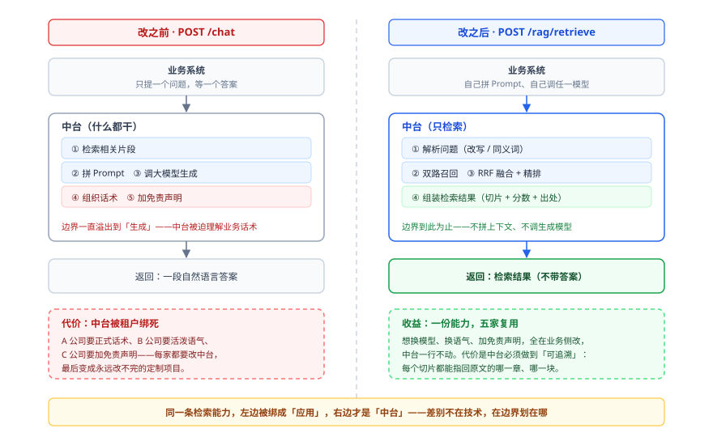

# RAG-Core 设计决策

写第一行代码之前，先理解这个系统为什么这么设计、难在哪、代价是什么。下面五个决策每一条都能在代码里找到回声，也各有一条明码标价的代价。本章决策与第 2 步新增的双入口契约另见 [ADR-0008](adr/0008-dual-entry-error-contract.md)。

## 决策一：只返回切片，不生成答案

这是整个项目最重要的一条边界，也是它区别于「又一个 ChatGPT 套壳」的地方。检索接口叫 `POST /rag/retrieve`，不叫 `chat`。



左右两边用的检索能力完全相同，差别只在于**边界划在哪一格**。左边「组织话术、加免责声明」这两步一旦进了中台，中台就开始理解业务话术，也就再也复用不了。

**为什么不做生成？** 一旦中台开始替租户拼上下文、出答案，它就又退化成了「应用」而非「中台」。租户想换模型、换提示词、换话术，都得改中台；中台的接口也会被某一家的 Prompt 风格绑死。把生成留在业务侧，中台只交付「可信的检索结果」，双方边界才干净。

**代价是什么？** 因为不生成答案，所以系统**必须有很好的可追溯性**——每一段返回的内容都要能指回原文的哪一段。这解释了很多设计：切块时保留章节路径（`heading_path`）而不是切成没有上下文的碎块；返回结果里带 `document_id`、`chunk_id`、`score`、`kb_id`；检索日志记录完整查询链路。

换句话说，**放弃了「替用户写答案」的便利，换来了「结果可审计、可复用、可替换模型」的自由**。

## 决策二：索引与检索必须是两条链路

这是最容易忽略、但最要紧的一个分离。读写特征完全不同：

| 对比 | 索引链路（写） | 检索链路（读） |
| --- | --- | --- |
| 触发频率 | 低（传文档时才跑） | 高（每次提问都跑） |
| 单次耗时 | 秒级到分钟级（要调 Embedding、要写两个库） | 毫秒级（目标 P95 < 2 秒） |
| 执行方式 | **异步**（丢给 Celery Worker） | **同步**（请求内跑完） |
| 失败影响 | 只影响这一篇文档，可以重试 | 直接影响用户体验 |
| 状态管理 | 需要状态机（处理中 / 成功 / 失败） | 无状态 |

**如果把索引做成同步的**：用户上传一个 50 页的 PDF，接口要等十几秒才返回，HTTP 连接一直挂着，Nginx 可能超时断开，用户以为失败了又点一次，同一篇文档被索引两遍。而且这篇文档的索引失败，不该让整个服务变慢。

所以索引必须异步，检索必须同步——用户问问题，等不了。

**代价是什么？** 多了一整套异步基础设施：Redis 当 broker、Celery Worker 当执行者、文档表要有 `status` 状态机（`status=3` 表示处理中）、要有重试与失败标记、运维要多盯一个进程。这是用「复杂度」换「响应速度」的典型交易。

## 决策三：六类 Provider 抽象，业务层不认识具体厂商

外部能力全部收口到 `app/providers/` 下，按**能力类型**分目录，而不是按厂商分目录。

| Provider 类别 | 目录 | 负责什么 | 换掉它意味着 |
| --- | --- | --- | --- |
| Embedding | `providers/embedding/` | 文本 → 向量 | 换 embedding 模型 |
| VectorStore | `providers/vectorstores/` | 向量库读写（pgvector） | 换向量数据库 |
| KeywordSearch | `providers/keyword_search/` | 关键词检索（ES） | 换 ES 或换成别的检索引擎 |
| LLM | `providers/llm/` | 大模型调用（查询改写、检索结果组装） | 换大模型厂商 |
| Rerank | `providers/rerank/` | 重排 | 换重排模型，或先空实现 |
| DocumentParser | `providers/parsers/` | docx / pdf / md 解析适配 | 换解析库 |

> 判据是「有没有自己的外部依赖」，且**按最终生产形态算**：Rerank 一期是包着 `LLMProvider` 的 `LLMRerankProvider`，二期才有自己的 `Qwen3RerankProvider` 与独立端点，所以计入六类。
>
> 查询改写与同义词**不在这一层**：借 `LLMProvider` 出网、同义词是纯函数读知识库级词表，没有自己的外部依赖，归属业务编排层的 `app/services/query/`。

**为什么按能力分，不按厂商分？** 按厂商分会变成 `providers/openai/`、`providers/qwen/`，业务代码迟早会写 `if provider == "qwen"`。按能力分，业务层只依赖抽象接口，具体实现由配置决定。判断标准很朴素：**换掉向量库要改几个文件？答案应该是个位数。**

**代价是什么？** 多了一层间接、多了一堆接口定义和工厂代码，第一版看起来「为了一个 HTTP 调用写三个文件」。而且抽象一旦定错（比如接口里漏了 `filter` 参数），后面每加一个能力都要改一圈。这是用「前期啰嗦」换「后期可替换」。

## 决策四：业务错误也返回 HTTP 200

HTTP 入口下 `/api/v1/*` 的所有接口统一返回：

```json
{ "code": 0, "msg": "success", "data": { ... } }
```

`code = 0` 是成功，非 0 是失败。**业务失败时 HTTP 状态码也是 200**；服务内部异常（未捕获异常）是 HTTP 500 + `code = 50000`。

**为什么？** 对调用方来说，「你给的 API Key 无效」和「我的服务器崩了」是两种完全不同的问题：前者调用方自己能处理，后者要报警找运维。如果都用 HTTP 500，调用方就分不清该重试还是该改配置。

所以约定（**仅 HTTP 入口**）：**HTTP 状态码只表达「HTTP 协议层面有没有问题」，业务层面的事一律看 `code`。** `/health`、`/docs`、`/openapi.json` 与写错路径的 404 保持 FastAPI 原生，不走这套响应体。MCP 入口（第 11 步）不适用本规则：它按 JSON-RPC 用 `result.isError = true` + 文本带 `code` 表达工具执行失败，见 [ADR-0008](adr/0008-dual-entry-error-contract.md)。

**代价是什么？** 调用方要写两层判断（先看 HTTP，再看 `code`）；监控、APM 这类只看 HTTP 状态码的工具会「看不见」业务失败，需要额外埋点。

> 这条最容易被下一个工程师当成 bug「顺手修掉」。它的反常是有意的。

## 决策五：共享表 + 行级 `tenant_id` 隔离

多租户有三种常见做法：

| 做法 | 隔离强度 | 成本 |
| --- | --- | --- |
| 每个租户一个独立数据库 | 最强（物理隔离） | 最高，迁移要跑 N 遍 |
| 每个租户一个独立 schema | 中等 | 中 |
| **共享表 + 行级 `tenant_id`** | 靠代码保证 | 最低 |

选了第三种。好处是部署最简单、迁移一次生效、资源利用率最高。

**代价是什么？** **所有隔离全靠代码逻辑**——一旦某个查询忘了带 `tenant_id`，就会跨租户泄露数据。这不是性能问题，是安全事故。

所以用一种很硬的办法：**把数据库访问全部收口到 Repository 层，方法签名强制要求 `tenant_id` 参数**，业务层没有别的路可以绕过去。配合「跨租户访问返回不存在而非无权限」，攻击者也探测不出资源在谁手里。

## 关键概念

术语正名见 [GLOSSARY](../GLOSSARY.md)，这里只讲容易误解的几个。

**RAG** —— Retrieval-Augmented Generation。大模型不知道你公司的内部文档，所以回答问题前先去文档库里检索出几段最相关的内容，塞进提示词，让模型「看着材料回答」。这个项目做的是前半段——检索。生成交给别人。

**为什么检索要单独做成中台** —— 检索这一半比想象中难得多，而且和具体业务无关。切多粗、怎么切、用向量找还是用关键词找、找到之后怎么排序、多个库一起查怎么合并——这些问题的答案对所有业务都一样。做成中台，一次做对，五家复用。

**向量（embedding）** —— 把一段文字变成一串数字，语义相近的两段文字在空间里也靠得近。于是「找相似内容」变成了「算距离」。

**召回（recall）** —— 从成千上万个切片里先粗筛出几十个可能相关的候选。追求「别漏」，不追求「准」，后面再重排。

**降级（degradation）** —— 某个零件坏了，系统不整体崩掉，而是用一个次优方案继续跑，**同时把这个事实告诉调用方**。比如 ES 挂了就只用向量检索，结果质量差一点但请求还是成功的。这是「生产可用」和「能演示」的分水岭。

## 难点在哪

1. **「异步」不是一个开关，是一整套状态机** —— 文档从上传到可检索，中间有排队、解析、切块、向量化、双写五个阶段，每个阶段都可能失败。设计 `status` 字段和重试语义，比写检索逻辑更难。
2. **「降级」不等于「静默忽略错误」** —— 降级的完整定义是「换方案继续跑 **+ 明确标记**」。只做前半句就是隐瞒故障，比直接报错更危险。要在每个降级点都记得往 `metadata.degraded` 里写一笔。
3. **平台层横切两条链路，最容易画错位置** —— 它不处理业务，却要拦在链路入口上。把它画成「最上面一层」是常见错误，它是**横跨**的。
4. **观测层必须是旁路** —— Langfuse 挂了不能影响主流程，这意味着所有 trace 调用都得包在 `try/except` 里，不能用箭头串进主链路。

## 常见误区

**误区一：以为「中台」就是「把接口包一层」** —— 中台的价值在于「一套能力被多方复用」。如果只是把某个业务系统的接口暴露出去，那叫「开放接口」，不叫中台。判断标准是**有没有把共性能力抽象出来**：六类 Provider 抽象、套餐与档位双层约束、统一错误码，少了这些就只是个能跑的 Demo。

**误区二：把索引链路和检索链路合成一条** —— 「不都是处理文档吗，为什么要分开？」因为读写特征完全不同：写低频、慢、需要状态机；读高频、快、无状态。合成一条，必然一边将就另一边。

**误区三：以为降级就是「静默忽略错误」** —— 见上文「难点」第 2 条。

**误区四：以为分层是为了「代码好看」** —— 分层的唯一目的是**让下次改动只影响一处**。判断分层好不好，就看「换掉向量库要改几个文件」。

**误区五：跳过架构直接看代码** —— 代码量不算大，但设计决策密度很高。先看架构，读代码时才知道「为什么这么写」；直接读代码，很容易把某个刻意设计当成啰嗦。

## 一句话记住

> **平台层横着切、索引异步写、检索同步读；只给切片不给答案；除了 PostgreSQL，什么坏了都降级，降级要留痕。**

## 错误码全表

> 本表在第 2 步**一次性落地**到 `ErrorCode(IntEnum)`（`app/core/exceptions.py`）；`3xxxx` 段仅预留、暂无成员；后续只追加新码、不改动已有编号。MCP 入口（第 11 步）复用同一套码，但用 JSON-RPC `isError` 呈现，见 [ADR-0008](adr/0008-dual-entry-error-contract.md)。

| 码 | 枚举名 | 含义 | 典型触发 | 调用方该做什么 |
| --- | --- | --- | --- | --- |
| `0` | SUCCESS | 成功 | — | 用 `data` |
| `20002` | REQUEST_VALIDATION_ERROR | 参数校验失败 | 字段缺失 / 类型错 | 改参数 |
| `20005` | API_RATE_LIMIT | QPS 超限 | 一秒内请求太多 | 退避重试 |
| `20008` | KNOWLEDGE_BASE_NOT_FOUND | 知识库不存在或无权访问 | kb_id 错 / 跨租户 | 检查 kb_id |
| `20010` | UNAUTHORIZED | API Key 无效或缺失 | 没带 / Key 错 / 过期 | 换 Key |
| `20011` | FORBIDDEN | 已登录但没权限 | 普通账号访问管理员接口 / 账号被停用 | 换管理员账号 |
| `20013` | FEATURE_NOT_ALLOWED | 功能超出套餐 | free 用 quality / 多库超限 / Research 无权限 | 降档或升级 |
| `20014` | QUOTA_EXCEEDED | 配额用尽 | 库数 / 文档数 / 并发数 / 日额度 | 升级或等待 |
| `20015` | PARAM_ERROR | 参数组合非法 | 命名档位传了质量参数 | 改 `profile=custom` |
| `20016` | NOT_FOUND | 资源不存在 | 文档 ID 错 | 检查 ID |
| `20017` | PLAN_NOT_FOUND | 套餐不存在 | 改 / 删一个不存在的 `plan_id` | 刷新套餐列表 |
| `20018` | PLAN_INVALID | 套餐参数非法 | `allowed_profiles` 含未知档位 / 上限 <= 0 | 改参数 |
| `20019` | PLAN_IN_USE | 套餐仍被引用 | 删一个还有账号在用的套餐 | 先给这些账号换套餐 |
| `20020` | FEEDBACK_FAILED | 反馈写入失败 | Langfuse 不可用 | 稍后重试 |
| `20021` | FEEDBACK_LOG_MISMATCH | log_id 与 trace_id 不匹配 | 错配或越权 | 检查 trace_id 归属 |
| `20022` | FEEDBACK_INVALID_SCORE | 分数越界 | 传了 0 或 6 | 传 1~5 |
| `20023` | DOCUMENT_PARSE_FAILED | 文档解析失败 | 格式不支持 / 文件损坏 / OCR 运行时缺失 | 换文件 |
| `20024` | DOCUMENT_CONTENT_EMPTY | 解析结果为空 | OCR 之后仍无可提取文字 | 改用文字版 |
| `20025` | DOCUMENT_IS_PROCESSING | 文档正在处理中 | 处理中删除或重建 | 等索引完成后再试 |
| `20026` | FILE_TOO_LARGE | 文件超过大小上限 | 上传超过 DOCUMENT_MAX_SIZE_MB | 压缩或拆分后重传 |
| `20027` | REINDEX_REQUIRES_FORCE | 重建需显式强制 | 对 SUCCESS 文档重建未带 force | 加 ?force=true |
| `40001` | API_TIMEOUT | 超时 | 模型服务慢 | 重试 |
| `40002` | API_REQUEST_ERROR | 请求错误 | 模型服务返回 4xx | 查配置 |
| `40003` | EMBEDDING_FAILED | 向量化失败 | Key 错 / 维度不对 | 查配置 |
| `40004` | RERANK_FAILED | 重排失败 | 重排服务异常 | 会降级 |
| `40005` | LLM_FAILED | 大模型调用失败 | 服务异常 | 会降级 |
| `50000` | SERVER_ERROR | 服务内部错误 | 未捕获异常 | 找运维 |
| `50001` | SYSTEM_BUSY | 系统繁忙 | 资源紧张 | 退避重试 |
| `50002` | RETRIEVAL_FAILED | 检索失败 | hybrid 两路都挂 | 检查依赖 |

**HTTP 状态码规则（仅 HTTP 入口 `/api/v1/*`）**：

| 情况 | HTTP | code |
| --- | --- | --- |
| 成功 | 200 | 0 |
| 业务错误（调用方能处理） | **200** | 非 0 |
| 服务内部异常（调用方无能为力） | **500** | 50000 |
| 非 `/api/v1/*`（`/health` / `/docs` / `/openapi.json` / 404） | FastAPI 原生 | 无 `code` |

MCP 入口不适用本表，见 [ADR-0008](adr/0008-dual-entry-error-contract.md)。

## 延伸阅读

- 系统怎么运转、模块怎么切 → [架构](架构.md)
- 每层用什么技术、版本为什么不锁 → [技术栈](技术栈.md)
- 这个系统解决什么问题 → [项目综述](项目综述.md)
- 双入口错误契约的完整决定与代价 → [ADR-0008](adr/0008-dual-entry-error-contract.md)

### 已落档的 ADR（决策的完整论证与代价）

本章决策与第 2 步新增契约的「为什么这么选、代价是什么、备选方案为何被否」，都在 `docs/adr/` 里有独立记录：

| 决策 | ADR |
| --- | --- |
| 只返回切片，不生成答案 | [0001](adr/0001-retrieve-not-chat.md) |
| 六类 Provider 与判据 | [0002](adr/0002-six-provider-categories.md) |
| API Key 即应用身份（删除 `app_id`） | [0003](adr/0003-api-key-is-app-identity.md) |
| API Key 本期明文存储 | [0004](adr/0004-plaintext-key-storage.md) |
| 文档版本纳入范围、与索引版本正交 | [0005](adr/0005-doc-version-in-scope.md) |
| 不做文档级 ACL | [0006](adr/0006-no-document-acl.md) |
| 业务错误返回 HTTP 200 + 分段错误码 | [0007](adr/0007-business-errors-http-200.md) |
| 双入口错误契约（HTTP 适配器 / MCP 适配器） | [0008](adr/0008-dual-entry-error-contract.md) |
